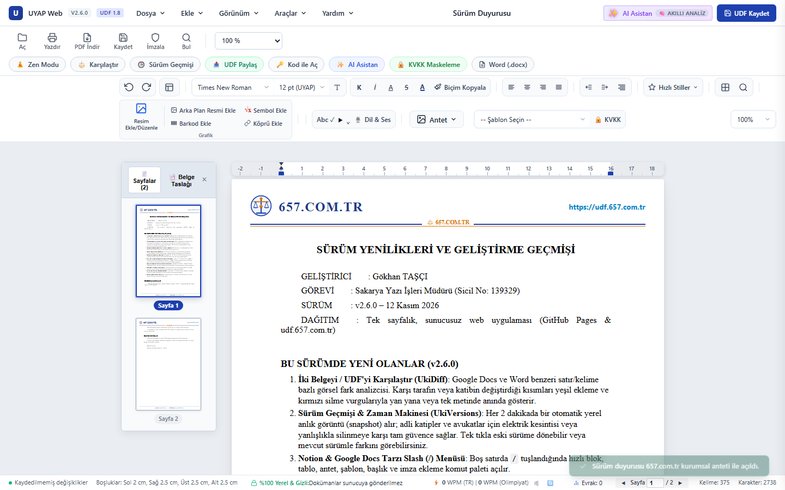
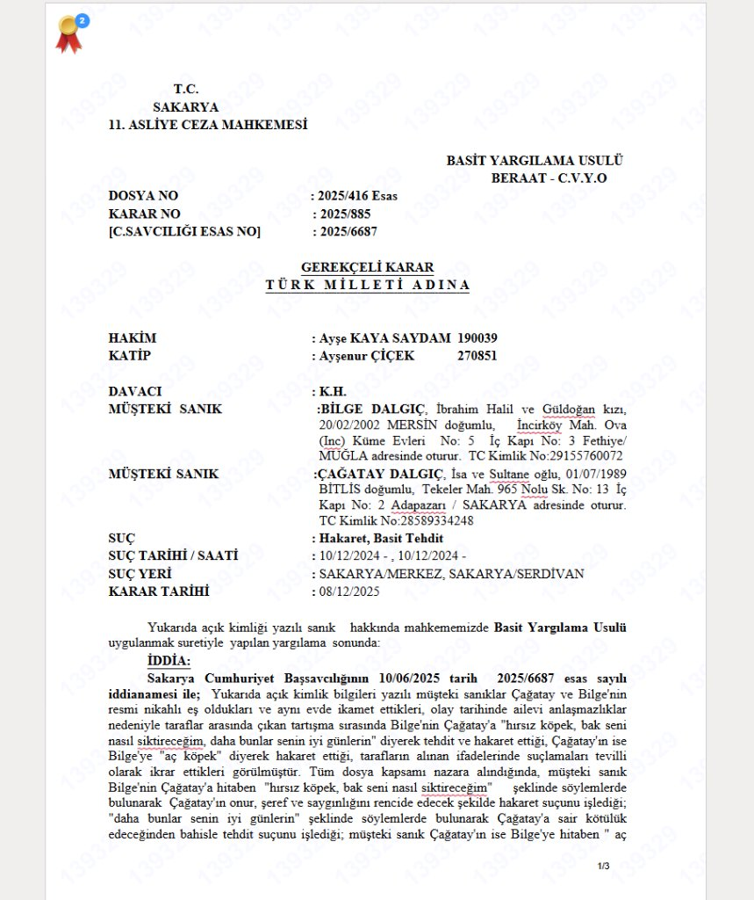
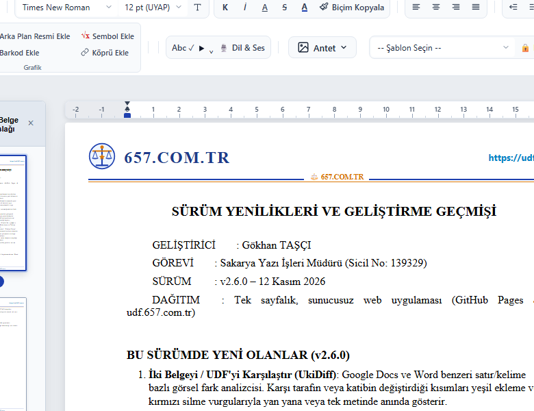
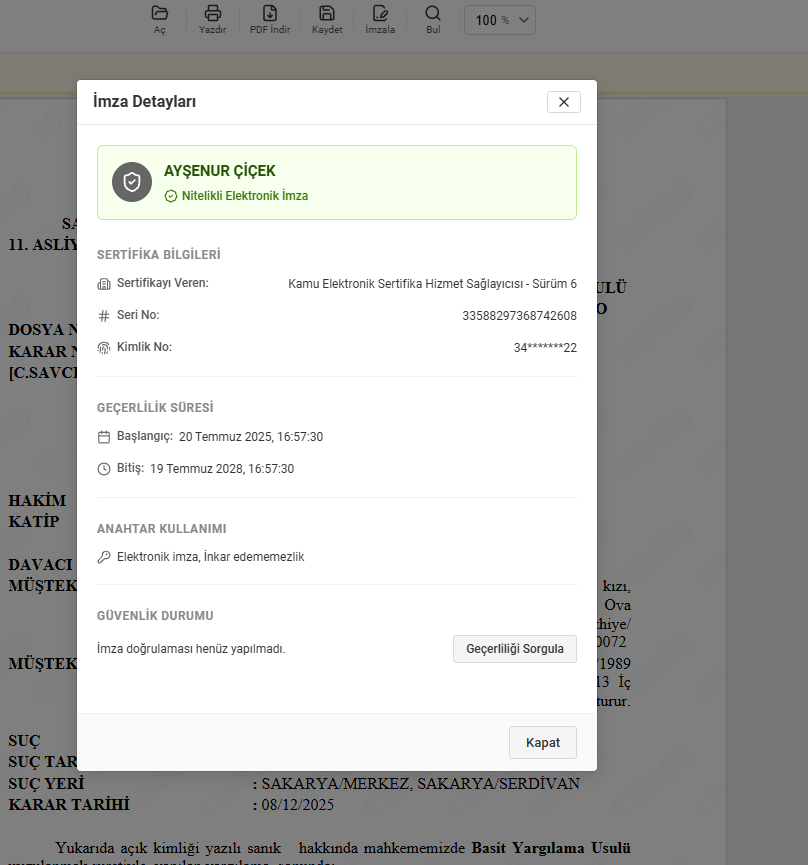
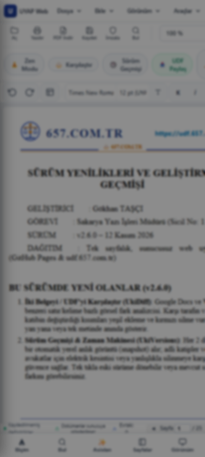

<div align="center">

# ⚖️ UYAP Web Kelime İşlemci (UDF Web Editor) & Ekosistemi

**Adalet Bakanlığı UYAP Doküman Formatı (`.udf`) İçin Bağımsız, Java Gerektirmeyen Yeni Nesil Web Editörü, Evrensel Dönüştürücü, Sanal Yazıcı ve Yerel Hukuk Yapay Zekası**

[](https://udf.657.com.tr/)
[](https://github.com/gokhantasci/uyap-kelime-islemci/stargazers)
[](https://github.com/gokhantasci/uyap-kelime-islemci/network/members)
[](https://github.com/gokhantasci/uyap-kelime-islemci/releases)
[](https://github.com/gokhantasci/uyap-kelime-islemci/releases)
[-success?style=for-the-badge)](#-100-yerel-ve-gizlilik-g%C3%BCvencesi)
[](LICENSE)

<br/>

<a href="https://udf.657.com.tr/">
  
</a>

<p align="center">
  <b>🌐 Canlı Uygulama:</b> <a href="https://udf.657.com.tr/">https://udf.657.com.tr</a> &nbsp;|&nbsp; 
  <b>📦 WordPress Eklentisi:</b> <a href="releases/uyap-kelime-islemci-wordpress-plugin.zip">WordPress ZIP İndir</a> &nbsp;|&nbsp; 
  <b>🚀 Son Sürümler:</b> <a href="https://github.com/gokhantasci/uyap-kelime-islemci/releases">GitHub Releases</a>
</p>

</div>

---

## 📌 Neden UYAP Web Kelime İşlemci?

Adalet Bakanlığı tarafından geliştirilen UYAP Doküman Editörü, Java JRE bağımlılığı ve işletim sistemi uyumsuzlukları nedeniyle özellikle mobil cihazlarda, Mac ve Linux sistemlerde veya Java yüklü olmayan modern bilgisayarlarda çalıştırılamamaktadır.

**UYAP Web Kelime İşlemci**, hiçbir program veya Java kurmadan:
- Doğrudan tarayıcıda `.udf` dosyalarını açar, görüntüler ve orijinal UYAP XML şemasına tam uyumlu olarak kaydeder.
- Sistem genelinde gerçek bir **"UYAP'a Yazdır (Print to UDF)"** sanal yazıcısı kurarak Chrome, Word, Excel, ERP veya herhangi bir programdan tek tıkla UDF çıktısı almanızı sağlar.
- **Python olan ve OLMAYAN tüm bilgisayarlarda** tek komutla çalışabilen yerel mimariye sahiptir.
- Yerleşik **Tarayıcı İçi Yapay Zeka Hukuk Asistanı** ile kararları anında özetler, davacı/davalı, esas/karar no, hüküm fıkrası ve istinaf/temyiz sürelerini otomatik tespit eder.
- **KVKK Maskeleme Modülü** ile kararlardaki T.C. Kimlik No, telefon, adres, isim ve kişisel verileri tek tıkla anonimleştirir.
- **%100 İstemci Taraflı (Zero-Server) Gizlilik**: Açtığınız veya yazdığınız hiçbir belge hiçbir sunucuya yüklenmez; tüm işlemler yalnızca bilgisayarınızın yerel RAM belleğinde yürütülür.

---

## 📸 Ekran Görüntüleri ve Arayüz Turu

<table align="center" width="100%">
  <tr>
    <td width="50%" align="center">
      <b>🤖 Yerel Yapay Zeka Hukuk Asistanı (Alt + A)</b><br/>
      <i>Belge kimliği, dava konusu, hüküm sonucu ve kanun yolu süre analizi</i><br/><br/>
      
    </td>
    <td width="50%" align="center">
      <b>🛡️ KVKK Otomatik Anonimleştirme ve Maskeleme</b><br/>
      <i>T.C. Kimlik, ad-soyad, adres ve doğum bilgilerini metin içinde korumalı gizleme</i><br/><br/>
      
    </td>
  </tr>
  <tr>
    <td width="50%" align="center">
      <b>🖼️ Gelişmiş Resim & Grafik Düzenleyici</b><br/>
      <i>UYAP piksel paritesi, en-boy kilidi, açı döndürme ve kenarlık ayarları</i><br/><br/>
      
    </td>
    <td width="50%" align="center">
      <b>📱 Mobil & Tablet Uyumlu Okuma Modu</b><br/>
      <i>Telefonda Java kurmadan doğrudan UDF inceleme ve düzenleme</i><br/><br/>
      
    </td>
  </tr>
</table>

---

## ⚡ Hızlı Başlangıç: Tek Komutla Kurulum

### 1. Windows PowerShell ile Tek Komutla Otomatik Kurulum

Aşağıdaki komutu PowerShell terminalinde çalıştırarak tüm sistemi (Masaüstü kısayolu, Windows Gezgini sağ tık menüleri, terminal `udf` komutları ve sistem sanal yazıcısını) saniyeler içinde otomatik kurabilirsiniz:

```powershell
# İnternet üzerinden tek komutla doğrudan kurulum:
irm https://raw.githubusercontent.com/gokhantasci/uyap-kelime-islemci/master/install.ps1 | iex

# Veya depoyu klonlayıp yerel dosyadan çalıştırma:
powershell -ExecutionPolicy Bypass -File .\install.ps1
```

> [!TIP]
> **Python Kurulu Olmayan Bilgisayarlar İçin Tam Destek (Python-Free Fallback):**
> Bilgisayarınızda Python kurulu olmasa bile kurulum sihirbazı hata vermez. Windows'un yerleşik `Microsoft Print To PDF` sürücüsü ve native PowerShell arka plan izleyicisi (`PrintToUDF_Watcher.ps1`) sayesinde sanal yazıcı ve masaüstü web editörü sıfır harici yazılımla sorunsuz çalışır!

**Kurulum neleri kapsar?**
* **Masaüstü & Başlat Menüsü:** Tek tıkla açılan "UYAP Kelime İşlemci" web editörü kısayolu.
* **Sanal Yazıcı (Print to UDF):** Yönetici olarak çalıştırıldığında Windows Yazıcılar arasına *"UYAP'a Yazdır (Print to UDF)"* aygıtını ekler.
* **Sağ Tık Menü Entegrasyonu:** Windows Gezgini'nde herhangi bir `.pdf`, `.docx`, `.md`, `.txt`, `.png`, `.jpg` dosyasına sağ tıklayıp **"UDF'e Dönüştür (Print to UDF)"** seçebilirsiniz.
* **.UDF Dosya Entegrasyonu:** `.udf` dosyalarına sağ tıklayıp **"UYAP Editöründe Aç"** seçeneği ile doğrudan web editöründe görüntüleme.
* **Windows 'Gönder (SendTo)' Menüsü:** Dosyaları sağ tıklayıp `Gönder > UYAP'a Yazdır` ile dönüştürebilme.
* **Terminalden Evrensel `udf` Komutu:** CMD ve PowerShell üzerinden `udf dosya.pdf` veya `udf karar.udf` komutlarını çalıştırabilme.
* **Temiz Kaldırma:** Dilediğiniz zaman `.\uninstall.ps1` veya `.\install.ps1 -Uninstall` ile tüm sistem kayıtlarını tek hamlede geri alabilirsiniz.

---

### 2. Docker ile Tek Komutla Mikroservis & Web Editörü

Hem modern web editörünü hem de arka plan dönüştürme REST API'sini Docker ile tek komutta ayağa kaldırabilirsiniz:

```bash
# Docker Compose ile tek komutla başlatma:
docker compose up -d

# Veya Docker CLI ile doğrudan çalıştırma:
docker run -d --name uyap-editor -p 8080:8080 uyap-kelime-islemci:latest
```

Artık tarayıcınızdan:
* **Web Editörü:** `http://localhost:8080`
* **Sağlık Denetimi (Healthcheck):** `http://localhost:8080/api/health`
* **Headless REST API Uç Noktası:** `http://localhost:8080/api/convert`

#### cURL ile REST API Dönüştürme Örnekleri:
```bash
# PDF dosyasını UDF'e dönüştür ve indir:
curl -X POST "http://localhost:8080/api/convert?filename=karar.pdf" \
     --data-binary "@karar.pdf" \
     -o "karar.udf"

# UDF dosyasını Markdown (.md) formatına dönüştür:
curl -X POST "http://localhost:8080/api/convert?filename=karar.udf&format=md" \
     --data-binary "@karar.udf" \
     -o "karar.md"
```

---

## 🖨️ "UYAP'a Yazdır" - Evrensel Sistem Sanal Yazıcısı

Bu araç yalnızca bir PDF çevirici değildir; **bilgisayarınızdaki herhangi bir programdan yazdırılabilir olan HER ŞEYİ doğrudan UDF formatına dönüştürür**.

```
Herhangi bir Program (Word, Chrome, Excel, ERP, Muhasebe)
                 │
           [ Ctrl + P ]
                 ▼
      Yazıcı: "UYAP'a Yazdır"
                 │
                 ▼
   Spooler Yakalama (PrintToUDF)
   ├── Python Varsa: PyMuPDF ile tam mizanpajlı UDF üretimi
   └── Python Yoksa: PowerShell Spool Watcher + udf.657.com.tr
                 │
                 ▼
     Sonuç: Anında Hazır .UDF Dosyası!
```

### 1. Herhangi Bir Programdan Yazdırma (Ctrl+P / Cmd+P)
Sisteme tek komutla sanal yazıcıyı ekleyin:
```bash
python print_to_udf.py --install
```
*(veya `install.ps1` dosyasını Yönetici Olarak Çalıştırın)*

Kurulum tamamlandıktan sonra:
* **Google Chrome / Microsoft Edge:** Herhangi bir web sayfasında, e-Devlet belgesinde veya e-Postada `Ctrl + P` yapıp yazıcı olarak **"UYAP'a Yazdır (Print to UDF)"** seçin -> Otomatik olarak `.udf` dosyası oluşturulur.
* **Microsoft Word / LibreOffice:** Düzenlediğiniz belgeyi `Ctrl + P` ile doğrudan UDF olarak yazdırın.
* **Microsoft Excel / Muhasebe / ERP:** Tablolar ve faturalar doğrudan UYAP Tablosu (`<table border="borderCell">`) olarak UDF'e aktarılır.
* **Notepad / Metin Editörü:** Tüm metinler UYAP paragrafları olarak mizanpajı korunarak basılır.

### 2. Doğrudan Dosya Dönüştürme Desteği
Herhangi bir dosyayı doğrudan komut satırından veya grafik arayüzden UDF'e çevirebilirsiniz:
```bash
# Herhangi bir dosyayı doğrudan UDF'e dönüştürme:
python print_to_udf.py dilekce.docx          # Word -> UDF
python print_to_udf.py hesap_tablosu.xlsx     # Excel -> UDF Tablo
python print_to_udf.py karar.pdf             # PDF -> UDF
python print_to_udf.py mevzuat.html          # HTML -> UDF
python print_to_udf.py notlar.txt            # Metin -> UDF

# Grafik Kullanıcı Arayüzünü (GUI) Açma:
python print_to_udf.py --gui

# Arka Plan Yazdırma Servisini Başlatma:
python print_to_udf.py --daemon
```

---

## 🌟 Temel Özellikler

- **Kurulumsuz & Sıfır Bağımlılık:** Java JRE veya yerel yazılım kurmaya gerek yoktur. Chrome, Firefox, Edge ve Safari gibi tüm modern masaüstü ve mobil tarayıcılarda çalışır.
- **🤖 Tarayıcı İçi Yapay Zeka Hukuk Asistanı (`Alt+A`):** Açılan kararları analiz eder; *"Davanın konusu nedir, mahkeme ne karar verdi, kanun yolu ve istinaf süresi ne kadar?"* sorularını yanıtlar (%100 yerel ve gizli).
- **🛡️ KVKK Maskeleme & Anonimleştirme:** TCKN, ad, soyad, telefon, adres ve hassas kişisel verileri tespit ederek UYAP standartlarında yıldızlar veya gizler.
- **Doğrudan Bağlantı ile UDF Açma (`linkac=URL.udf`):** İnternet üzerindeki herhangi bir dosyayı `https://udf.657.com.tr/?linkac=https://site.com/belge.udf` şeklinde tek tıkla editörde açabilirsiniz.
- **Sürükle & Bırak Desteği:** Masaüstünüzdeki `.udf` dosyasını tarayıcı penceresine sürükleyip bırakarak anında görüntüleyebilirsiniz.
- **Zengin Metin Editörü:**
  - Yazı tipi (Times New Roman, Arial, Calibri vb.) ve punto boyutları
  - Kalın, İtalik, Altı Çizili, Üstü Çizili ve metin renkleri
  - Paragraf hizalama (Sola, Ortala, Sağa, İki Yana Yasla) ve girinti ayarları
  - Tablo ekleme, hücre birleştirme, satır/sütun yönetimi ve sayfa sonu desteği
  - Resim ekleme, boyutlandırma, en-boy oranı kilitleme ve açı döndürme
- **Elektronik İmza (.sgn) İnceleme:** İmzalı belgelerin sertifika bilgilerini, imzalayan kimliğini ve doğrulama kodlarını görüntüler.
- **Word (.docx) Olarak İndirme:** Editördeki herhangi bir kararı veya metni, tabloları ve stilleri bozulmadan doğrudan Microsoft Word (.docx) olarak indirebilirsiniz.
- **Yazdır & PDF Desteği:** A4 sayfa düzeni koruyarak doğrudan PDF veya fiziksel yazıcı çıktısı alabilirsiniz.

---

## 🔌 WordPress Eklentisi: UYAP Kelime İşlemci (Web UDF)

WordPress tabanlı hukuk siteleri, barolar, mevzuat portalları veya bloglar için hazır resmi eklenti paketi:

[-21759b?style=for-the-badge&logo=wordpress&logoColor=white)](releases/uyap-kelime-islemci-wordpress-plugin.zip)

### 1. Kurulum
1. [uyap-kelime-islemci-wordpress-plugin.zip](releases/uyap-kelime-islemci-wordpress-plugin.zip) dosyasını indirin.
2. WordPress yönetim panelinizde **Eklentiler > Yeni Eklenti Ekle > Eklenti Yükle** kısmından yükleyin.
3. **Eklentiyi Etkinleştir** butonuna basın.

### 2. Kısa Kodlar (Shortcodes) ile Kullanım
Yazılarınıza veya sayfalarınıza tek bir kısa kod ekleyerek editörü veya görüntüleyiciyi yayınlayabilirsiniz:

* **Boş / Yeni UDF Düzenleyici Ekleme:**
  ```text
  [uyap_editor width="100%" height="700px" theme="light"]
  ```

* **Belirli Bir UDF / Karar Dosyasını Görüntüleme (Viewer):**
  ```text
  [uyap_viewer src="https://udf.657.com.tr/assets/data/ornek-belge.udf" width="100%" height="650px"]
  ```

---

## 🌐 Web Sitenize Gömme: Hafif Editör & Görüntüleyici (Embed SDK)

Kendi web sitenize veya hukuk portalınıza tek satır kodla hafif UDF doküman düzenleyicisi veya görüntüleyicisi gömebilirsiniz:

### 1. Tek Satır Script ile Kullanım

```html
<!-- Hafif Düzenleyici (Editor Modu: Yazma, Biçimlendirme, UDF İndirme) -->
<script src="https://udf.657.com.tr/embed.js" data-mode="editor" data-theme="light" data-width="100%" data-height="700px"></script>

<!-- Salt Okunur Görüntüleyici (Viewer Modu: Uzak UDF dosyasını sayfada okutma) -->
<script src="https://udf.657.com.tr/embed.js" data-mode="viewer" data-src="https://udf.657.com.tr/assets/data/ornek-belge.udf" data-theme="light" data-width="100%" data-height="700px"></script>
```

### 2. Boş Bir HTML Dosyasında Doğrudan Test Etme (Örnek Şablon)

Boş bir HTML belgesinde denemek için dosyanızı aşağıdaki gibi standart `<body>` etiketleri arasına yerleştirerek oluşturabilirsiniz:

```html
<!DOCTYPE html>
<html lang="tr">
<head>
    <meta charset="UTF-8">
    <title>UYAP Editör Embed Testi</title>
</head>
<body style="font-family: sans-serif; background: #f8fafc; padding: 20px;">
    <h2>UYAP Doküman Editörü</h2>
    <!-- Editör burada otomatik olarak oluşturulacaktır -->
    <script src="https://udf.657.com.tr/embed.js" data-mode="editor" data-theme="light" data-width="100%" data-height="700px"></script>
</body>
</html>
```

*(Detaylı çalışan tam örnek için depodaki [`examples/embed-demo.html`](examples/embed-demo.html) dosyasına göz atabilirsiniz.)*

---

## 📂 Proje Yapısı

```
uyap-kelime-islemci/
├── .github/
│   └── workflows/
│       ├── deploy.yml                   # GitHub Pages otomatik dağıtım iş akışı
│       └── release.yml                  # Otomatik sürüm derleme ve varlık paketleme
├── assets/
│   ├── css/
│   │   ├── style.css                    # A4 sayfa düzeni, araç çubuğu, modallar ve stil şablonları
│   │   └── editor-refinements.css       # Piksel hizalamaları, kenarlık ve mizanpaj iyileştirmeleri
│   ├── data/
│   │   ├── sozluk-657.json              # Hukuki terimler ve imla denetim sözlüğü
│   │   ├── uyap-ai-training-data.json   # Yerel yapay zeka hukuk modeli referans veri seti
│   │   └── surum-duyurusu.md            # Sürüm geçmişi ve yenilik bildirimleri
│   ├── images/
│   │   └── antet/                       # Kurumsal antet, mahkeme ve hukuk bürosu şablon görselleri
│   ├── js/
│   │   ├── app.js                       # Arayüz kontrolleri, dosya yönetimi ve eylemler
│   │   ├── site-config.js               # Canlı site ve domain yapılandırması (udf.657.com.tr)
│   │   ├── uki-core.js                  # UDF (ZIP/XML) ayrıştırma, docx & markdown motoru
│   │   ├── uki-editor.js                # WYSIWYG düzenleme ve imleç yönetimi
│   │   ├── uki-pages.js                 # A4 sayfa bölücü ve sayfalama motoru
│   │   ├── uki-image.js                 # Resim ekleme, boyutlandırma, en-boy kilidi ve döndürme
│   │   ├── uki-table.js                 # Excel / Word zengin tablo motoru
│   │   ├── uki-ai.js                    # Tarayıcı içi yapay zeka & WebGPU belge analiz asistanı
│   │   ├── uki-seal.js                  # Bağımsız elektronik imza mührü
│   │   ├── uki-embed.js                 # Dış sitelerden linkac=URL ile döküman açıcı
│   │   └── uki-stats.js                 # Anonim kullanım istatistiği
│   └── vendor/
│       └── jszip.min.js                 # İstemci taraflı ZIP kütüphanesi
├── docs/
│   └── images/                          # Dokümantasyon ekran görüntüleri ve arayüz önizlemeleri
├── releases/                            # İndirilebilir hazır dağıtım paketleri
│   └── uyap-kelime-islemci-wordpress-plugin.zip # WordPress resmi eklenti arşivi
├── tests/                               # Otomasyon testleri
│   ├── run_tests.js                     # 39 birim web test paketi
│   ├── test_services.py                 # REST API, güvenlik ve CORS testleri
│   └── test_uyap_parity.py              # UYAP XML şema uyumluluk ve parite testleri
├── tools/
│   └── build_releases.py                # Dağıtım paketlerini ZIP olarak derleme betiği
├── wordpress-plugin/                    # WordPress eklenti kaynak kodları
│   └── uyap-kelime-islemci/
│       ├── uyap-kelime-islemci.php
│       └── readme.txt
├── CNAME                                # Özel alan adı tanımı (udf.657.com.tr)
├── Dockerfile                           # Docker konteyner tanımı
├── docker-compose.yml                   # Docker Compose yapılandırması
├── embed.html                           # Gömülebilir hafif editör HTML sayfası
├── embed.js                             # Web sitelerine gömme JavaScript kütüphanesi
├── index.html                           # Ana web editörü arayüzü
├── install.ps1                          # Tek komutla Windows kurulum sihirbazı (Python bağımsız)
├── open_in_editor.py                    # Masaüstü yerel loopback sunucusu ve dosya açıcı
├── print_to_udf.py                      # Evrensel sistem sanal yazıcısı ve dönüştürücü motoru
├── PrintToUDF_Watcher.ps1               # Python-free yerel Windows sanal yazıcı izleyicisi
├── package.json                         # Node.js proje bağımlılıkları ve test komutları
├── robots.txt                           # Arama motoru indeksleme yönergeleri
├── sitemap.xml                          # Site haritası
├── uninstall.ps1                        # Temiz sistem kaldırma betiği
└── README.md                            # Proje dokümantasyonu
```

---

## 🧪 Testler ve Kalite Güvencesi

Projedeki tüm dönüştürme algoritmaları, UYAP XML şemaları ve REST servisleri kapsamlı test suiteleri ile güvence altına alınmıştır:

```bash
# Web ve JavaScript testlerini çalıştırma (39 test):
npm test

# REST API ve Loopback güvenlik testlerini çalıştırma:
python tests/test_services.py

# UYAP XML parite ve dönüştürme doğruluk testlerini çalıştırma:
python tests/test_uyap_parity.py
```

---

## 👨‍💻 Geliştirici ve İletişim

**Gökhan TAŞÇI**  
Sakarya Yazı İşleri Müdürü (Sicil No: 139329)  
- 🌐 **Web Sitesi:** [udf.657.com.tr](https://udf.657.com.tr) & [657.com.tr](https://657.com.tr)
- 🐙 **GitHub:** [@gokhantasci](https://github.com/gokhantasci)
- ⚖️ **Proje Deposu:** [uyap-kelime-islemci](https://github.com/gokhantasci/uyap-kelime-islemci)

---

## ⚖️ Lisans

Bu proje [MIT Lisansı](LICENSE) altında sunulmaktadır.
Dilediğiniz gibi kullanabilir, değiştirebilir ve kendi projelerinize entegre edebilirsiniz.
